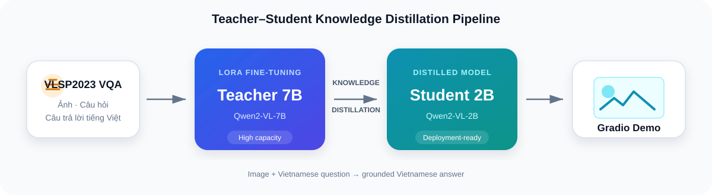

<p align="center">
  
</p>

<p align="center">
  <a href="https://www.python.org/"></a>
  <a href="https://huggingface.co/Ouyangxuelili"></a>
  <a href="https://www.gradio.app/"></a>
  <a href="LICENSE"></a>
</p>

<p align="center">
  Hệ thống hỏi đáp hình ảnh tiếng Việt sử dụng <strong>Qwen2-VL</strong>,
  <strong>LoRA fine-tuning</strong> và <strong>Knowledge Distillation</strong>.
</p>

<p align="center">
  <a href="#-chạy-demo-ngay">Chạy demo</a> ·
  <a href="#-mô-hình-và-dữ-liệu">Model & Dataset</a> ·
  <a href="#-kiến-trúc">Kiến trúc</a> ·
  <a href="https://huggingface.co/Ouyangxuelili">Hugging Face</a>
</p>

---

## Tổng quan

**Vietnamese VQA Distillation** nhận một hình ảnh và câu hỏi tiếng Việt, sau đó sinh câu trả lời dựa trên nội dung quan sát được. Dự án xây dựng một cặp mô hình Teacher–Student:

- **Teacher 7B**: mô hình lớn, ưu tiên chất lượng câu trả lời.
- **Student 2B**: mô hình gọn hơn, được chưng cất tri thức từ Teacher để giảm tài nguyên khi triển khai.
- **Gradio App**: giao diện web hỗ trợ chọn model, kiểu trả lời và độ dài đầu ra.
- **Pipeline đầy đủ**: tải dữ liệu, fine-tune Teacher, distill Student, đánh giá và inference.

> Các repository model chứa **LoRA adapter sau fine-tune**. Khi chạy, ứng dụng ghép adapter với Qwen2-VL base model tương ứng. Bạn không cần train lại để dùng demo.

## Điểm nổi bật

| Khả năng | Mô tả |
|---|---|
| Hỏi đáp hình ảnh tiếng Việt | Nhận ảnh và câu hỏi tự nhiên bằng tiếng Việt |
| Hai cấu hình suy luận | Teacher 7B cho chất lượng, Student 2B cho tốc độ |
| Chạy không cần train lại | Tự lấy adapter công khai từ Hugging Face khi không có output local |
| Offline-ready | Có lệnh tải trước base model và adapter vào máy |
| Cấu hình hóa | Dataset, model, training và distillation được quản lý bằng YAML |
| Giao diện hiện đại | Upload ảnh, câu hỏi gợi ý, tùy chỉnh độ chi tiết và theo dõi thời gian |

## Kiến trúc

<p align="center">
  
</p>

Quy trình gồm hai giai đoạn chính:

1. Fine-tune **Qwen2-VL-7B-Instruct** bằng LoRA trên dữ liệu VQA tiếng Việt để tạo Teacher.
2. Dùng Teacher truyền tri thức cho **Qwen2-VL-2B-Instruct**, tạo Student nhẹ hơn cho demo và triển khai.

## Mô hình và dữ liệu

Tất cả tài nguyên đã được xuất bản công khai dưới namespace Hugging Face [`Ouyangxuelili`](https://huggingface.co/Ouyangxuelili):

| Tài nguyên | Vai trò | Base model | Hugging Face |
|---|---|---|---|
| Qwen-7B-Vi-VQA | Teacher sau fine-tune | Qwen2-VL-7B-Instruct | [Mở model](https://huggingface.co/Ouyangxuelili/Qwen-7B-Vi-VQA) |
| Qwen-2B-ViVQA | Student sau distillation | Qwen2-VL-2B-Instruct | [Mở model](https://huggingface.co/Ouyangxuelili/Qwen-2B-ViVQA) |
| VLSP2023 VQA | Dữ liệu train/dev/test | Ảnh + câu hỏi + câu trả lời | [Mở dataset](https://huggingface.co/datasets/Ouyangxuelili/vlsp2023-vqa-dataset) |

Ứng dụng ưu tiên adapter trong `outputs-*/final_lora/`. Nếu không tìm thấy, model loader tự tải adapter từ Hugging Face. Base model được lấy từ namespace chính thức `Qwen` hoặc thư mục `models/` nếu đã tải trước.

## Chạy demo ngay

### 1. Clone và cài đặt

```bash
git clone https://github.com/OuyangXuelili/Vietnamese-VQA-Distillation.git
cd Vietnamese-VQA-Distillation

python -m venv .venv
```

Kích hoạt môi trường:

```powershell
# Windows PowerShell
.\.venv\Scripts\Activate.ps1
```

```bash
# Linux / macOS
source .venv/bin/activate
```

Cài bộ thư viện chỉ dành cho demo:

```bash
pip install -r requirements-app.txt
```

### 2. Kiểm tra nguồn model

```bash
python app.py --check
```

Kết quả sẽ cho biết từng adapter đang được lấy từ local hay Hugging Face.

### 3. Mở giao diện

```bash
python app.py
```

Truy cập `http://127.0.0.1:7860`. Lần chạy model đầu tiên sẽ lâu hơn vì phải nạp base model và adapter; các câu tiếp theo không phải nạp lại.

Để tạo URL tạm thời khi chạy trên Colab mà không phụ thuộc `gradio.live`:

```bash
python -u scripts/run_colab_demo.py
```

### Tải trước để chạy offline

```bash
# Student 2B: lựa chọn khuyên dùng cho demo
python app.py --download-model 2b
python app.py --download-adapter 2b

# Hoặc tải cả Teacher và Student
python app.py --download-model all
python app.py --download-adapter all
```

## Chạy trên Google Colab

Nếu project đã được lưu tại `MyDrive/TtI/Vi-VQA-End-to-End`, mở
[`notebooks/colab-demo.ipynb`](notebooks/colab-demo.ipynb), chọn **T4 GPU** và chạy
toàn bộ notebook. Notebook sẽ:

- mount Google Drive;
- chép mã nguồn và hai adapter vào `/content` để giảm độ trễ;
- dùng base model đang lưu trên Drive mà không nhân đôi hơn 20 GB dữ liệu;
- cài dependencies, kiểm tra nguồn model và mở Gradio qua public URL tạm thời;
- tự kết nối lại tunnel nếu đường truyền công khai bị ngắt, không làm dừng server Gradio.

Nếu không dùng bản trên Drive, có thể clone repository rồi chạy thủ công:

```python
!git clone https://github.com/OuyangXuelili/Vietnamese-VQA-Distillation.git
%cd Vietnamese-VQA-Distillation
!pip install -q -r requirements-app.txt
```

```python
!python -u scripts/run_colab_demo.py
```

Launcher này giữ Gradio ở `127.0.0.1:7860` và tạo tunnel riêng qua
`localhost.run`. Hãy mở URL nằm sau dòng `DEMO_URL:` và giữ cell cuối tiếp tục
chạy. Không dùng lại URL của lần chạy trước vì mỗi phiên Colab sẽ tạo một URL
tạm thời mới.

Với repository GitHub đang để **Private**, Colab cần được xác thực GitHub trước khi clone. Các model và dataset Hugging Face hiện là public nên không cần token để chạy demo.

## Cấu hình phần cứng

| Chế độ | GPU đề xuất | Ghi chú |
|---|---:|---|
| Student 2B FP16 | NVIDIA T4 15 GB trở lên | Lựa chọn mặc định, cân bằng tốc độ và bộ nhớ |
| Teacher 7B 4-bit | Khuyến nghị L4/A100 | Có thể vừa T4 nhưng nạp 5 shard từ Drive rất chậm và phiên miễn phí có thể bị ngắt |
| CPU | RAM khoảng 8 GB cho 2B, 20 GB cho 7B | Có thể chạy nhưng rất chậm, không khuyến nghị |
| Training/Distillation | GPU 40 GB+ | Chỉ cần khi muốn huấn luyện lại |

## Training và distillation

Demo không yêu cầu train lại. Phần này chỉ dùng khi muốn tái tạo hoặc cải tiến model.

```bash
pip install -r requirements.txt

# Fine-tune Teacher 7B
python scripts/train.py \
  --config-dir configs \
  --output-dir outputs-7B \
  --resume

# Distill Student 2B
python scripts/distill.py \
  --config-dir configs \
  --output-dir outputs-2B-distilled \
  --resume

# Đánh giá
python scripts/evaluate.py --model-type both --output-file results/comparison.json
```

Chi tiết tham số có tại [scripts/README.md](scripts/README.md).

## Cấu trúc repository

```text
Vietnamese-VQA-Distillation/
├── app.py                       # Giao diện Gradio
├── assets/                      # Hình ảnh cho README
├── configs/                     # Cấu hình data/model/training/distillation
├── data/                        # Hướng dẫn và cache dataset local
├── hub_cards/                   # Model card và dataset card
├── notebooks/                   # Notebook Colab/Jupyter
├── scripts/                     # Train, distill, evaluate, inference
├── src/
│   ├── data/                    # Dataset loader và tiền xử lý
│   ├── models/                  # Model loader, wrapper và inference
│   └── training/                # Training loop và tiện ích
├── requirements-app.txt         # Dependencies tối thiểu cho demo
└── requirements.txt             # Dependencies đầy đủ cho nghiên cứu
```

Các thư mục `models/`, `outputs-7B/`, `outputs-2B-distilled/` và cache dữ liệu được bỏ qua bởi Git vì có dung lượng lớn. Trọng số được quản lý trên Hugging Face.

## Lệnh hữu ích

```bash
python app.py --help
python scripts/train.py --help
python scripts/distill.py --help
python scripts/inference.py --help
python scripts/evaluate.py --help
```

## Tài liệu

- [Data loading](src/data/DATA_LOADING.md)
- [Model module](src/models/README.md)
- [Training module](src/training/README.md)
- [Scripts](scripts/README.md)
- [Dataset notes](data/README.md)
- [Lộ trình nâng cấp](ROADMAP.md)

## Tác giả và giấy phép

Project được duy trì bởi **[OuyangXuelili](https://github.com/OuyangXuelili)**.

Mã nguồn được phát hành theo [MIT License](LICENSE). Qwen2-VL, dataset và các thư viện bên thứ ba tiếp tục tuân theo giấy phép và điều khoản tương ứng của chủ sở hữu.
